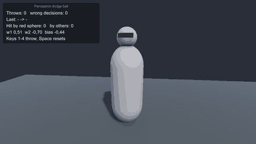

# Perceptron: mantık kapıları, sınıflandırma ve deneyimden öğrenme (Unity 6.3)

BLM5026 Bilgisayar Oyunlarında Yapay Zeka · Rapor 7 (Hafta 8) · Veysel Uğurlu
Bursa Teknik Üniversitesi, Bilgisayar Mühendisliği Yüksek Lisans · Doç. Dr. İzzet Fatih Şentürk



Perceptron iki girdiyi ağırlıklarla çarpıp toplar, bias ekler ve sonuç sıfırdan büyükse 1 verir. Yanlış cevap verdikçe ağırlıklarını düzeltir. Bu projede aynı fikir üç sahnede kullanılıyor: VEYA, VE ve XOR öğrenmek, nesneleri yiyecek ve silah olarak ayırmak, ve bir karakterin yalnızca kırmızı toplardan eğilerek kaçmayı öğrenmesi.

| Deney | Sonuç |
|---|---|
| VEYA / VE (100 seed) | hepsi öğrenildi, ortalama 3.8 / 6.2 epoch |
| XOR (100 seed, 1000 epoch) | hiçbiri öğrenilemedi: tek bir doğru XOR'u ayıramaz |
| Yiyecek / silah, 14 nesne (100 seed) | hepsi ayrıldı, ortalama 5.2 epoch |
| DodgeBall (30 seed, 40 atış) | ortalama 2.1 yanlış karar, 15. atıştan sonra hiç yanlış yok |

Ayrıntılı açıklama, kodlar, Excel ödevi ve bütün deneyler: [docs/week08/README.md](docs/week08/README.md)

## Çalıştırma

1. Unity Hub → Add project from disk → bu klasör (Unity 6000.3.x).
2. `Assets/Perceptron2026/` altındaki sahnelerden birini açın (`LogicGates`, `SimpleGrapher/Perceptron`, `DodgeBall`) → Play.
3. DodgeBall'da 1-4 tuşları nesne atar, Space perceptron'u sıfırlar.

## Proje yapısı

```
Assets/Perceptron2026/LogicGates/      VEYA, VE, XOR perceptron'u ve sahnesi
Assets/Perceptron2026/SimpleGrapher/   yiyecek / silah sınıflandırması ve grafik
Assets/Perceptron2026/DodgeBall/       eğilmeyi öğrenen karakter, atış ve deney sürücüsü
Assets/Perceptron2026/Editor/          sahne kurucu, deneyler, rapor görüntüleri (menü: Perceptron)
docs/week08/                           rapor sayfası, grafikler, veriler, Excel dosyası
tools/                                 Excel, deney, grafik ve animasyon scriptleri (Python)
```

Her hafta ayrı bir `feature/...` dalında geliştirilir ve Pull Request ile `main` dalına birleştirilir.
