# Rapor 7 (Hafta 8): Perceptron

BLM5026 Bilgisayar Oyunlarında Yapay Zeka · Veysel Uğurlu · Unity 6.3 LTS (6000.3.25f1) · Universal 3D · Input System 1.20.0

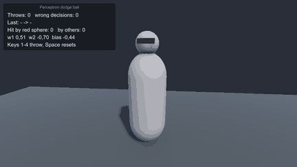

*Karakter, kendisine atılan nesneye bakıp eğilip eğilmeyeceğine bir perceptron ile karar veriyor. Seed 4: ilk atışta yeşil küp için gereksiz yere eğiliyor, 5. atışta kırmızı topa çarpılıyor, 6. atıştan sonra yalnızca kırmızı toplarda eğiliyor.*

## 1. Bu hafta ne yapıldı?

Perceptron, bir sinir hücresini taklit eden en basit öğrenen programdır. İki sayı alır, her birini bir ağırlıkla çarpıp toplar, toplama bir sabit (bias) ekler. Sonuç sıfırdan büyükse 1, değilse 0 verir. Yanlış cevap verdiğinde ağırlıklarını hatanın yönünde biraz değiştirir. Bu hafta aynı fikir üç ayrı Unity sahnesinde uygulandı:

| Sahne | Perceptron neyi öğreniyor? | Sonuç (ölçülen) |
|---|---|---|
| `LogicGates` | VEYA, VE ve XOR işlemleri | VEYA 100 seed'in hepsinde ortalama 3.8 epoch'ta, VE 6.2 epoch'ta öğrenildi. XOR 1000 epoch'ta bile öğrenilemedi |
| `SimpleGrapher/Perceptron` | Bir nesnenin yiyecek mi silah mı olduğu (keskinlik, yenebilirlik) | 14 nesnenin hepsi 100 seed'de ayrıldı (ortalama 5.2 epoch) |
| `DodgeBall` | Atılan nesne kırmızı top mu? (eğil / eğilme) | 30 seed, 40 atış: ortalama 2.1 yanlış karar, en geç 15. atıştan sonra hiç yanlış yok |

Ayrıca VEYA, VE ve XOR eğitimini adım adım hesaplayan bir Excel dosyası hazırlandı: [excel/perceptron_adim_adim.xlsx](excel/perceptron_adim_adim.xlsx).

## 2. Temel kavramlar

| Kavram | Anlamı | Bu projede |
|---|---|---|
| Girdi (input) | Perceptron'a verilen sayılar | `input1`, `input2` (ör. keskinlik ve yenebilirlik) |
| Ağırlık (weight) | Her girdinin ne kadar önemli olduğu; öğrenilen değer | `weights[0]`, `weights[1]` |
| Bias | Girdilerden bağımsız sabit; eşiği kaydırır | `bias` |
| Aktivasyon | Toplamı 0 ya da 1'e çeviren kural | `toplam > 0` ise 1 (SimpleGrapher'da `>= 0`) |
| Eğitim kümesi | Doğru cevabı bilinen örnekler | `TrainingSet[] ts` |
| Hata | Beklenen çıktı ile bulunan çıktının farkı | `ts[j].output - CalcOutput(j)` |
| Epoch | Eğitim kümesinin baştan sona bir kez işlenmesi | `Train(epochs)` |
| Karar sınırı | Perceptron'un iki sınıfı ayırdığı doğru | `w1·x + w2·y + bias = 0` |

Güncelleme kuralı: `w_i ← w_i + hata · girdi_i`, `bias ← bias + hata`. Hata 0 ise hiçbir şey değişmez.

## 3. Proje yapısı

Üç örnekte de `Perceptron` ve `TrainingSet` adlı sınıflar var. Aynı projede çakışmamaları için her biri kendi namespace'inde duruyor (`LogicGates`, `Grapher`, `DodgeBall`); sınıf, alan ve metot adları değişmedi.

```
Assets/Perceptron2026/
├── LogicGates/      Perceptron.cs, LogicGates.unity (Perceptron_OR, _AND, _XOR)
├── SimpleGrapher/   Perceptron.cs, SimpleGrapher.cs, InitCube.cs, Perceptron.unity, blank.png
├── DodgeBall/       Perceptron.cs, Throw.cs, DodgeStats.cs, Lifetime.cs, DodgeExperiment.cs,
│                    DodgeBall.unity, Animation/ (Character.controller, Idle, Crouch), Prefabs/, Materials/
└── Editor/          sahne kurucu, deney koşucuları, rapor görüntüleri (menü: Perceptron)
tools/               Excel, deney, grafik ve animasyon scriptleri (Python)
docs/week08/         bu sayfa, veriler, grafikler, Excel dosyası
```

Sahneler kodla kurulur: Unity menüsünde Perceptron → Build All Scenes.

### Unity Editor'dan görüntüler

| | |
|---|---|
| 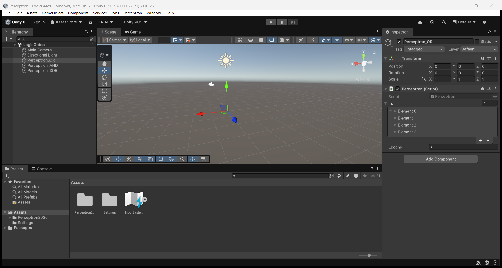 | 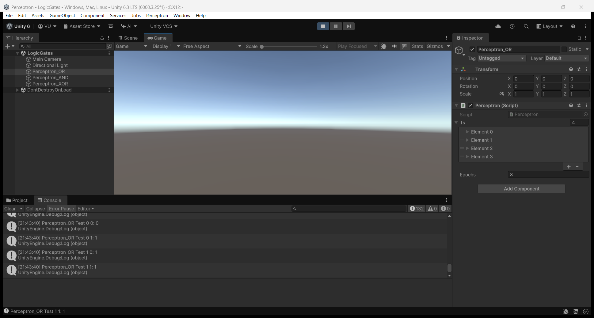 |
| *Perceptron_OR: 4 elemanlı eğitim kümesi, epochs = 8* | *Play: Console'da Test 0 0: 0, 0 1: 1, 1 0: 1, 1 1: 1* |
| 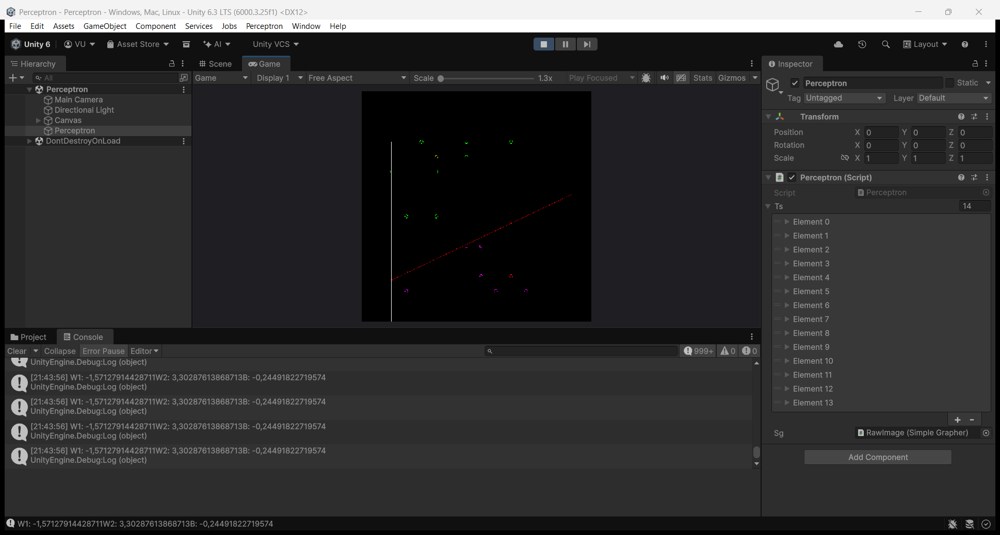 | 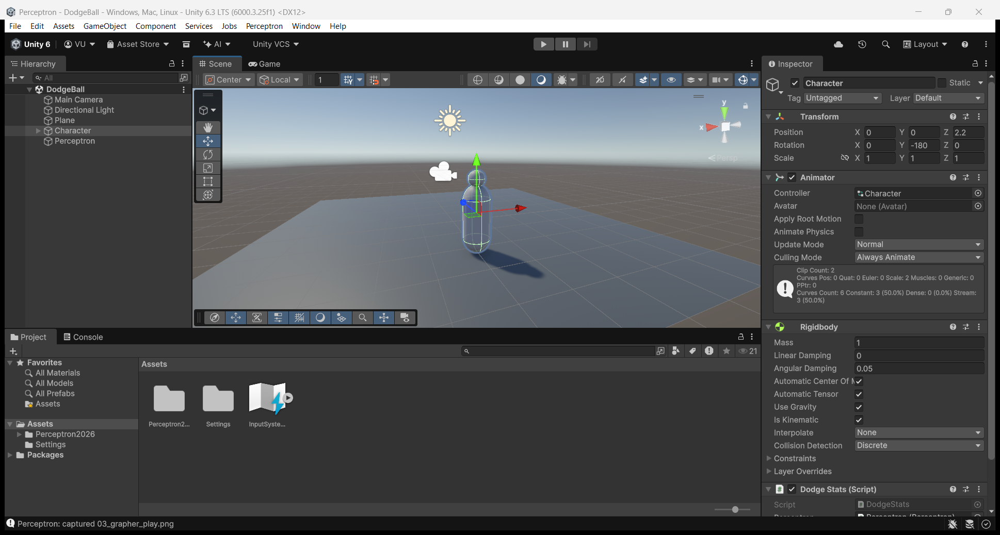 |
| *SimpleGrapher: 14 nokta ve öğrenilen karar doğrusu* | *DodgeBall karakteri: Animator, Rigidbody, DodgeStats* |
| 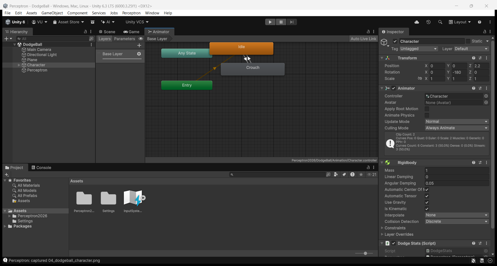 | 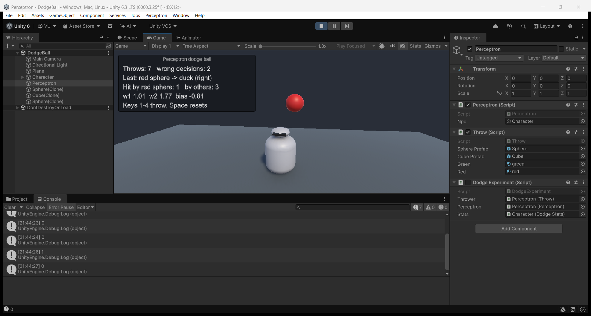 |
| *Animator: Idle → Crouch, "Crouch" tetikleyicisi* | *Play: 7 atış, kırmızı top geldiğinde eğiliyor* |

## 4. Mantık kapıları (VEYA, VE, XOR)

```csharp
double DotProductBias(double[] v1, double[] v2)   // w1·x1 + w2·x2 + bias
void UpdateWeights(int j)
{
    double error = ts[j].output - CalcOutput(j);
    totalError += Mathf.Abs((float)error);
    for (int i = 0; i < weights.Length; i++)
        weights[i] = weights[i] + error * ts[j].input[i];
    bias += error;
}
void Train(int epochs)   // InitialiseWeights, sonra her epoch'ta bütün kümeyi bir kez işle
```

Sahnede üç nesne aynı scripti taşıyor; yalnızca Inspector'daki eğitim kümesi farklı. VE işlemini öğretmek için kodda hiçbir şey değiştirilmedi.

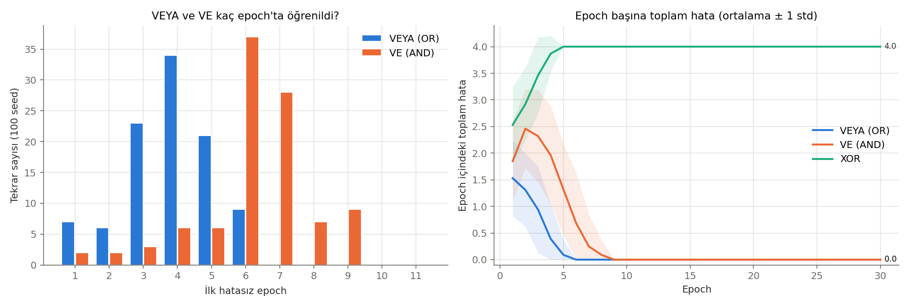

| İşlem | Öğrenilen tekrar | İlk hatasız epoch (ortalama, en az-en çok) | Son durum |
|---|---|---|---|
| VEYA | 100 / 100 | 3.8 (1-6) | 4 girdinin 4'ü doğru |
| VE | 100 / 100 | 6.2 (1-9) | 4 girdinin 4'ü doğru |
| XOR | 0 / 100 | yok (1000 epoch) | 68 tekrarda 2, 32 tekrarda 1 girdi doğru |

*Her işlem aynı 100 seed ile eğitildi: aynı seed aynı başlangıç ağırlıklarını verir. Veri: [data/logic_runs.csv](data/logic_runs.csv), [data/logic_epochs.csv](data/logic_epochs.csv).*

XOR için "kaç epoch gerekli?" sorusunun cevabı: hiçbir sayı yetmiyor. 5. epoch'tan sonra her epoch'un toplam hatası 4; her güncelleme bir önceki örneği bozuyor ve ağırlıklar bir döngüye giriyor.

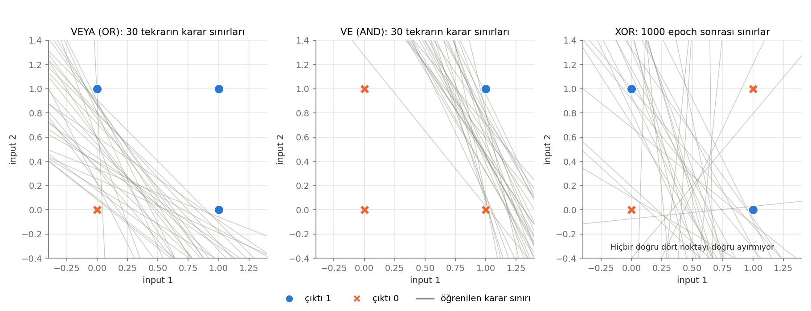

VEYA ve VE için noktaları ayıran sonsuz sayıda doğru var; her seed bunlardan birini buluyor. XOR'da (0,1) ve (1,0) noktaları 1, (0,0) ve (1,1) noktaları 0. Tek bir doğru bu dört noktayı iki gruba ayıramaz, perceptron'un karar sınırı ise her zaman bir doğrudur.

### Excel ödevi

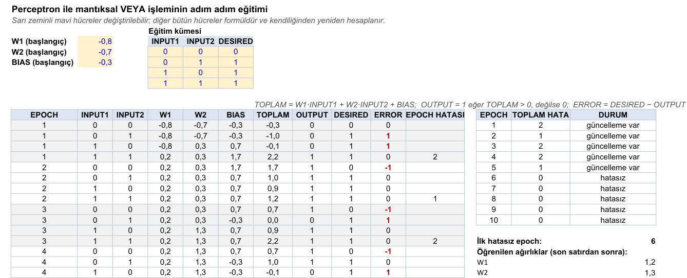

[excel/perceptron_adim_adim.xlsx](excel/perceptron_adim_adim.xlsx) dosyasında üç sayfa var (VEYA, VE, XOR). Sarı zeminli mavi hücreler (başlangıç ağırlıkları ve eğitim kümesi) değiştirilebilir; geri kalan bütün hücreler formül. VEYA sayfası ders örneğindeki ağırlıklarla başlıyor (w1 = -0.8, w2 = -0.7, bias = -0.3): ilk satır hatasız, ikinci satırda hata 1, ardından w2 = 0.3 ve bias = 0.7 oluyor. 6. epoch hatasız. VE sayfası ödev tablosundaki ağırlıklarla (0.4, 0.2, -0.3) başlıyor ve aynı tabloyu satır satır üretiyor: 6. epoch'ta hatasız, son ağırlıklar 1.4, 1.2, -2.3. Excel'deki 120 satır, bağımsız bir Python hesabıyla karşılaştırıldı ve hepsi aynı çıktı.

## 5. Yiyecek ve silah sınıflandırması (SimpleGrapher)

Her nesnenin iki özelliği var: keskinlik (sharp) ve yenebilirlik (edible). Perceptron 200 epoch eğitildikten sonra karar doğrusu ekrana çiziliyor ve iki yeni nesne sınıflandırılıyor: (0.3, 0.9) yiyecek (sarı), (0.8, 0.1) silah (kırmızı).

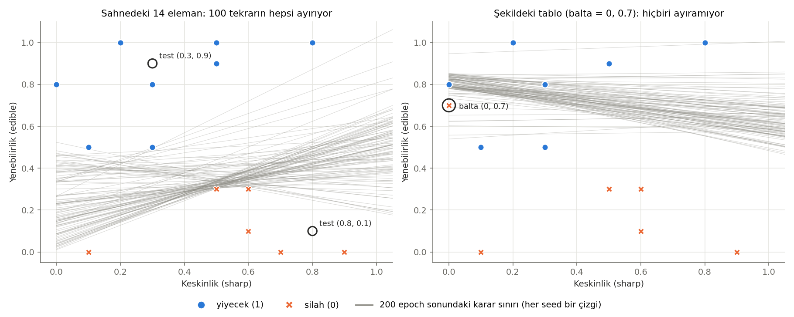

| Eğitim kümesi | Ayrılan tekrar | Tüm nesnelerin doğru olduğu ilk epoch | 200 epoch sonunda doğru |
|---|---|---|---|
| Sahnedeki 14 eleman | 100 / 100 | 5.2 (1-12) | 14 / 14 |
| Ders şeklindeki tablo (balta = 0, 0.7) | 0 / 100 | yok | ortalama 11.2 / 14 |

Ders şeklindeki tabloda balta "keskinlik 0, yenebilirlik 0.7" olarak yazılmış; paketteki sahnede ise (0.7, 0). Şekildeki değerle küme doğrusal olarak ayrılamıyor; bu, doğrusal programlama ile de kontrol edildi ([data/summary.json](data/summary.json), `separable`). Balta (0.7, 0) yazılınca ayrılabiliyor. Şekildeki değer büyük olasılıkla bir yazım hatası.

### Bulunan iki hata

1. `SimpleGrapher.DrawRay`, doğrunun bitiş noktasını `slope * x2` ile hesaplıyordu. `x2` piksel cinsinden ve 100 piksellik eksen kaydırmasını içeriyor; bu yüzden bitiş noktası "eğim × 100" piksel kayıyor ve çizilen doğru gerçek karar sınırından sapıyordu. Düzeltme: `slope * (x2 - xoffset)`. 100 seed'de bitiş noktasındaki sapma ortalama 30, en çok 76 piksel.

   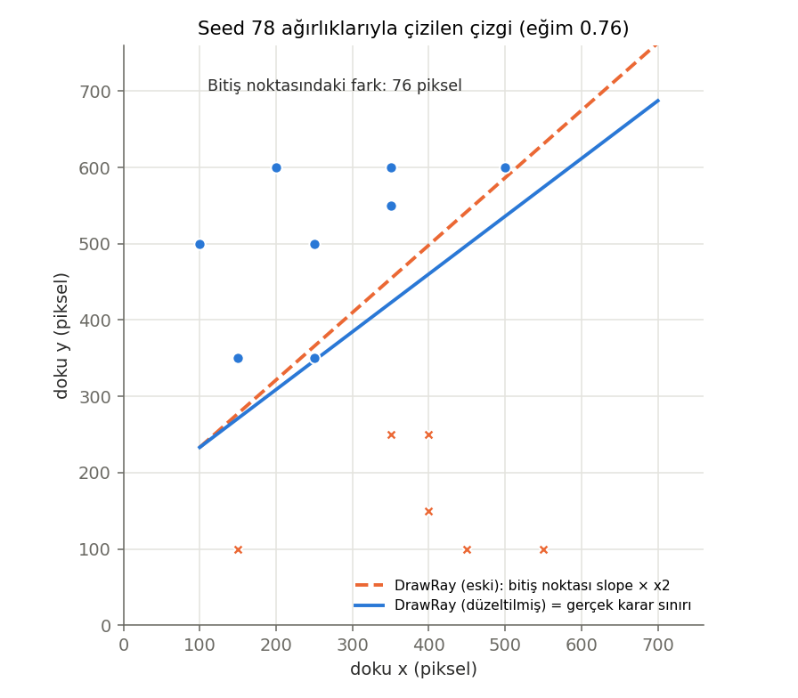

2. `Perceptron.Start` noktaları çizerken `SimpleGrapher.Start` henüz çalışmamış olabiliyor; o zaman doku `null` ve sahne NullReferenceException veriyor. İki `Start` metodunun sırası Unity'de tanımlı değil. SimpleGrapher'ın hazırlığı `Awake` metoduna taşındı; Awake her zaman bütün Start'lardan önce çalışır.

## 6. DodgeBall: deneyimden öğrenme

Oyuncu 1-4 tuşlarıyla nesne atıyor. Perceptron her atışta önce karar veriyor (eğil ya da dur), sonra o atışı eğitim kümesine ekleyip kümenin tamamı üzerinde bir epoch eğitiliyor.

| Tuş | Nesne | Girdi (şekil, renk) | İstenen çıktı |
|---|---|---|---|
| 1 | kırmızı küre | (0, 0) | 0 = eğil |
| 2 | yeşil küre | (0, 1) | 1 = dur |
| 3 | kırmızı küp | (1, 0) | 1 = dur |
| 4 | yeşil küp | (1, 1) | 1 = dur |

Bu tablo VEYA işleminin doğruluk tablosuyla aynı: karakter aslında VEYA öğreniyor.

Ders paketindeki karakter (Ethan) eski Standard Assets'ten geliyor ve yaklaşık 30 MB model ve doku içeriyor. Burada karakter bir kapsül, bir küre ve bir siperlikten kuruldu. `Character.controller` adlı Animator Controller'da Idle ve Crouch durumları ile "Crouch" tetikleyicisi var. Böylece `npc.GetComponent<Animator>().SetTrigger("Crouch")` satırı değişmeden çalışıyor. Eski `Input.GetKeyDown` çağrıları yeni Input System'e (`Keyboard.current`) çevrildi; projede eski giriş sistemi kapalı.

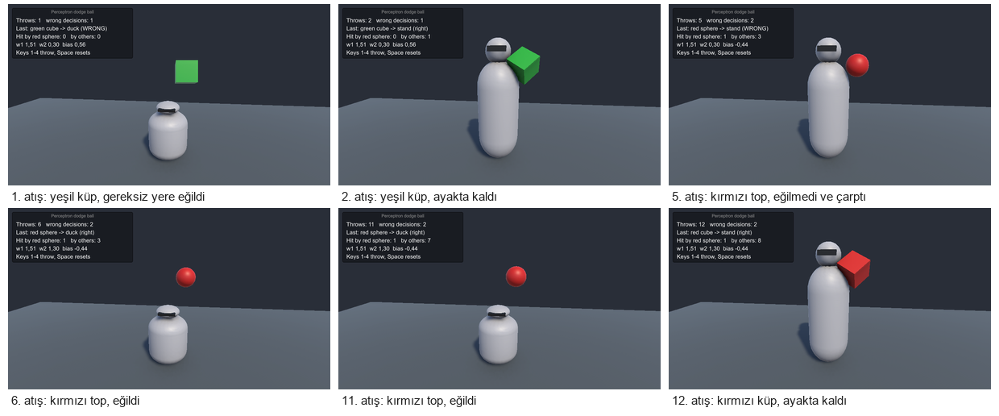

### Deney

Build pencere açmadan çalıştırıldı. 30 seed, her birinde 40 atış; atılan nesne seed'e bağlı rastgele bir diziden seçildi ([tools/run_dodgeball.py](../../tools/run_dodgeball.py)). Her karede oyun zamanı tam bir fizik adımı (0.02 s) ilerletildi; seed 1 iki kez çalıştırıldı ve iki CSV birebir aynı çıktı.

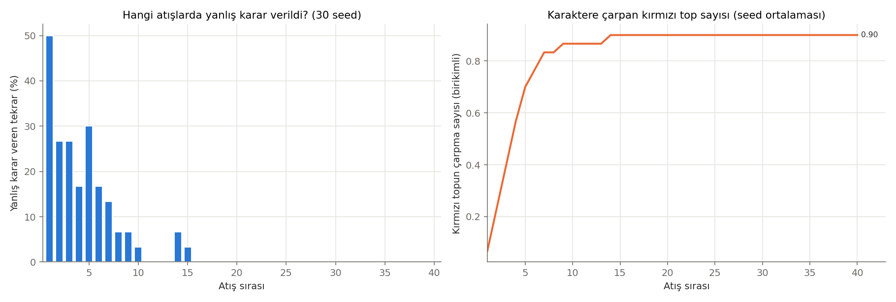

| Ölçüm | Değer |
|---|---|
| Seed başına yanlış karar | 2.07 ± 1.17 (0-5) |
| Son yanlış kararın verildiği atış | ortalama 5.6, en geç 15 |
| 15. atıştan sonraki yanlış karar | 0 |
| Kırmızı top atışı / karaktere çarpan | 298 / 27 (hepsi öğrenme bitmeden) |
| Ayakta kalınan atış = çarpan atış | 1200 / 1200 |

Son satır eğilmenin fiziksel olarak da işe yaradığını gösteriyor: karakter eğildiği hiçbir atışta vurulmadı, ayakta kaldığı her atışta vuruldu. Ham veri: [data/dodgeball_throws.csv](data/dodgeball_throws.csv).

## 7. Kısa sorular

1. Mantıksal VEYA 10 epoch'tan kısa sürede öğrenilirken XOR neden öğrenilemiyor? Perceptron girdileri tek bir doğruyla ikiye ayırır. XOR'un 1 ve 0 çıktıları çapraz konumda olduğu için onları ayıran bir doğru yok.
2. Karar sınırını ne belirliyor? Yalnızca ağırlıklar ve bias: `w1·x + w2·y + bias = 0`. Ağırlıklar doğrunun yönünü, bias onun konumunu belirliyor.
3. Aktivasyon fonksiyonunun rolü nedir? Sınırın yerini değiştirmez; toplamı sıfırdan büyük olan tarafı 1, öbür tarafı 0 yapar.
4. Kod değişmeden yeni bir işlem nasıl öğreniliyor? Öğrenilen her şey ağırlıklarda tutuluyor. Eğitim kümesi değişince ağırlıklar da yeni işleme göre ayarlanıyor.

## 8. Çalıştırma

1. Unity Hub → Add project from disk → depo klasörü (Unity 6000.3.x).
2. Sahneler: `Assets/Perceptron2026/LogicGates/LogicGates.unity`, `SimpleGrapher/Perceptron.unity`, `DodgeBall/DodgeBall.unity` → Play. DodgeBall'da 1-4 tuşları nesne atar, Space perceptron'u sıfırlar.
3. Deneyler: Perceptron menüsünden Run Logic Gate Experiments, Run SimpleGrapher Experiments ve Build DodgeBall Player, ardından `python tools/run_dodgeball.py` ve `python tools/plot_experiments.py`.

| Ortam | Sürüm |
|---|---|
| Unity | 6000.3.25f1 (Unity 6.3 LTS), Universal 3D şablonu, URP 17.3.0 |
| Giriş | Input System 1.20.0 (eski Input Manager kapalı) |
| Grafikler ve Excel | Python 3.11, matplotlib, numpy, openpyxl, Pillow; LibreOffice ile doğrulama |

## 9. Kaynaklar

- Ders sunusu: *Oyun Programlamada Yapay Zeka, Hafta 4: Perceptron*, BLM5026, 2026, ve SimpleGrapher, DodgeBall paketleri.
- F. Rosenblatt, "The Perceptron: A Probabilistic Model for Information Storage and Organization in the Brain", *Psychological Review*, 65(6), 1958.
- M. Minsky, S. Papert, *Perceptrons*, MIT Press, 1969.
- I. Millington, *AI for Games*, 3. baskı, CRC Press, 2019.
- Unity 6.3 Scripting API: `Animator.SetTrigger`, `MonoBehaviour.Awake`, `Texture2D.SetPixel`, Input System `Keyboard.current`.
